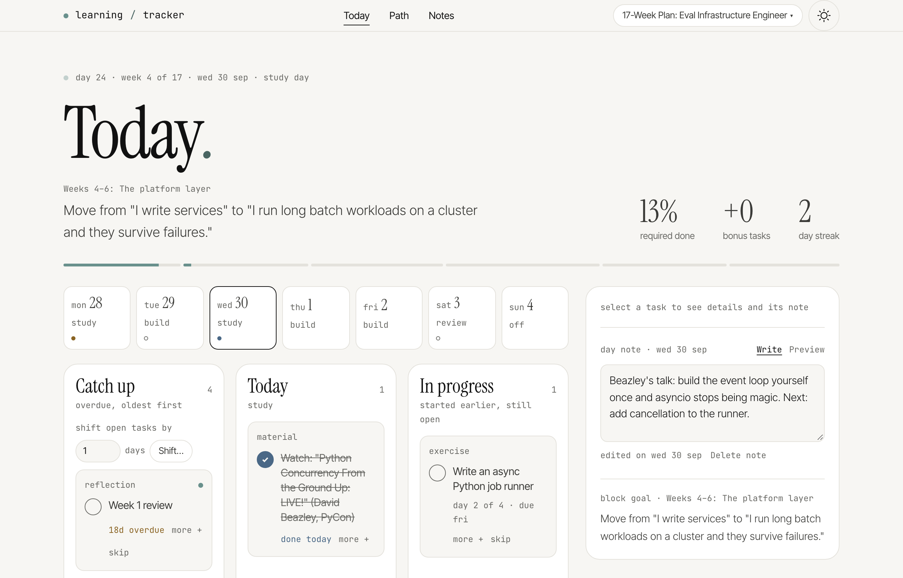
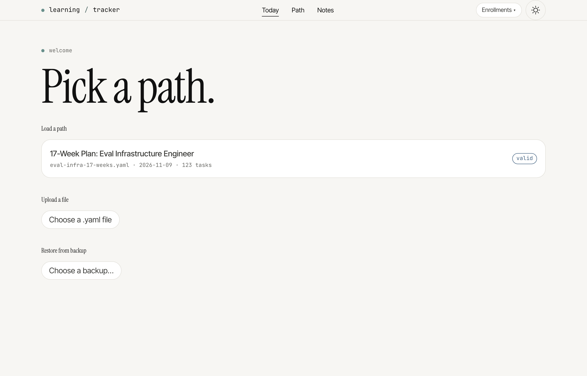
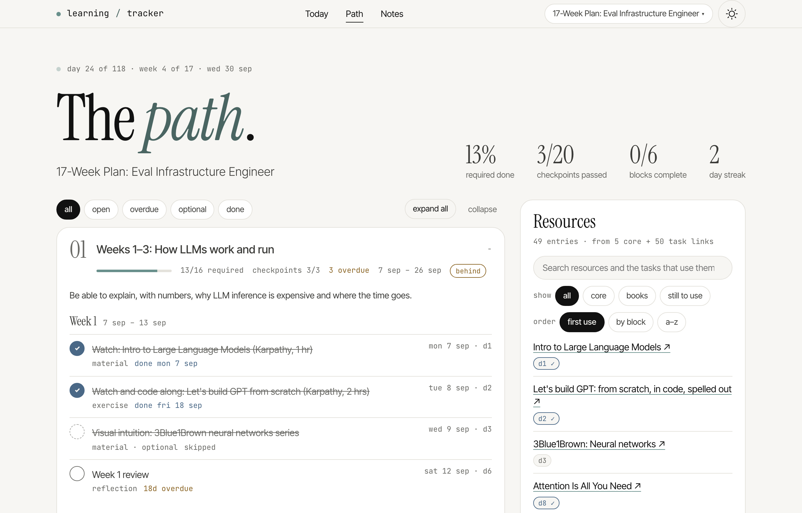
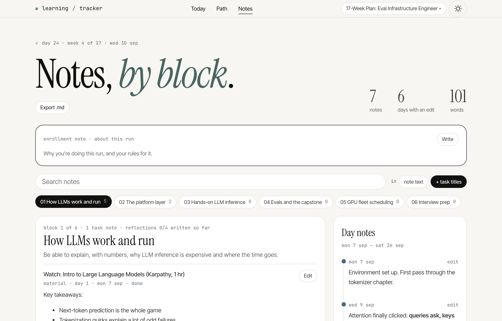
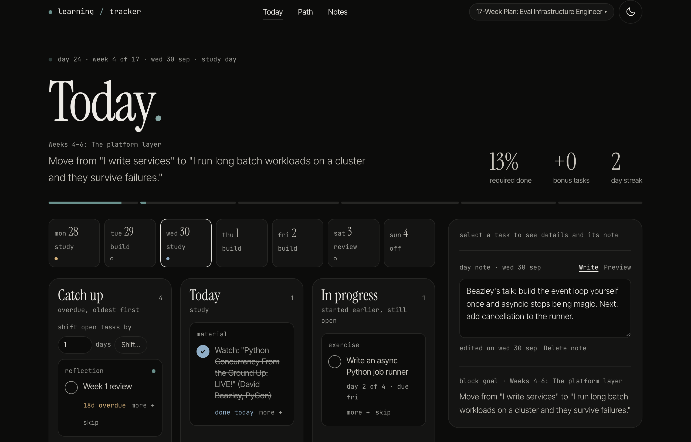

# Learning tracker

A locally run learning tracker. It loads a **Learning Path** (a YAML file of Blocks and Tasks, each Task on an explicit day) and turns it into a daily tracker: what to do today, what's overdue, Notes, and progress. There is one user, no login, and no automatic scheduling. You tick Tasks on the honour system, and the only thing that moves the schedule is a Schedule Shift you trigger yourself.

Paths are plain YAML. Write one by hand, or have an AI agent write one for you with the [`learning-path` skill](#generate-paths-with-an-ai-agent-the-learning-path-skill) in this repo.

It runs as one Docker container: Node + Fastify, React, and SQLite on a Docker volume.



## Run it

You need Docker with Compose v2.

```sh
cd app
cp .env.example .env    # optional: change PORT
docker compose up --build
```

Then open **http://localhost:4321**. The server prints `Learning tracker ready at http://localhost:4321` once it's listening. No browser opens by itself.

On first run the app offers to load a path from `app/paths/`, upload a YAML file, or restore a Backup. The 17-week sample path is already in `app/paths/`.

### Change the port

Set `PORT` in `app/.env` (or `PORT=8080 docker compose up`). The container always listens on 3000; `PORT` is the host port.

### Use it from other devices on your network

By default the app is published on `127.0.0.1` only. To reach it from your LAN, edit the one `ports` line in `app/compose.yaml`:

```yaml
ports: ["${PORT:-4321}:3000"]   # was "127.0.0.1:${PORT:-4321}:3000"
```

> **There is no login.** Anyone who can reach that port can read and change everything, including deleting Enrollments and restoring a Backup over your data. Only do this on a network you trust.

### Upgrade

```sh
cd app
git pull && docker compose up --build
```

Your data stays in the volume. When a new version changes the database layout, the server first writes a Safety Copy (see below) and then migrates.

## Using it

**1. Pick a path.** On first run, load a path from `app/paths/`, upload a YAML file, or restore a Backup. Choose the start date (Day 1); it defaults to the path's next start weekday (a Monday for the sample). To make a path of your own, see [Authoring Learning Paths](#authoring-learning-paths).



**2. Work from Today.** Today is the daily view:

- **Today** holds the Tasks scheduled for today, **In progress** holds multi-day Tasks still open, and **Catch up** lists overdue Tasks, oldest first.
- Tick the circle when a Task is done. Use **skip** for a Task you won't do and **more** for its description and links. Click a day in the week strip to look at it or tick its Tasks early.
- Click a Task title to open its Task Note in the side pane. The **Day Note** sits below it. Both save as you type, and support Markdown with a Write/Preview toggle.
- **Fallen behind?** In Catch up, **shift open tasks by N days** moves every open Task later, all at once. It's the only thing that ever changes the schedule, and **Undo** reverses it.

**3. See the whole run on Path.** Every Block, week and Task with its status, progress per Block and checkpoints. Filter by open, overdue, optional or done. The **Resources** panel lists every link in the path and which Tasks use it.



**4. Read back on Notes.** Every Note, grouped by Block, with search. Day Notes run down the right. **Export .md** downloads them all as one Markdown file, organised by Block → week → day.



**5. Keep a Backup.** In the app menu (the path title, top right), **Download backup** saves everything to a JSON file. The same menu restores a backup, switches between Enrollments and starts a new one.

The sun/moon button switches between light and dark themes; by default the app follows your system.



## Your data

> **Everything lives in the `appdata` Docker volume.** `docker compose down -v`, `docker volume rm`, or a Docker Desktop "clean up" **wipes all of it**: every Enrollment, tick and Note. **Download Backups** (app menu → *Download backup*) and keep them somewhere else.

- Compose names the volume after the folder it runs in, so it's `app_appdata` when you run from `app/`. `docker compose down` without `-v` keeps it.
- **"last backup: N days ago"** in the app menu is approximate. It records when the server finished sending a Backup, not whether you kept the file. A download you cancelled or deleted still counts. It also counts a Backup that was restored, since a restore brings back the backup's own date.
- **Restore** replaces everything (all Enrollments and the active one) after showing you a preview. It's all-or-nothing: a failed restore changes nothing.
- **Notes → Export** gives a Markdown file of one Enrollment's Notes, for reading or keeping elsewhere. It is not a Backup and can't be imported back.

### Safety Copies

The server writes automatic copies into the same volume (`/data` inside the container) before risky changes:

| When | File | Kept |
|---|---|---|
| Before a restore | `pre-restore-<timestamp>.json` (a full JSON Backup) | newest 3 |
| Before a database migration | `pre-migrate-v<old>-<timestamp>.db` (a SQLite copy) | newest 3 |

They live on the same volume as your data, so they **don't protect you from `down -v`**. To copy one out:

```sh
cd app
docker compose exec app ls /data
docker compose cp app:/data/pre-restore-<timestamp>.json .
```

A `pre-restore-*.json` file can be restored through the app like any Backup.

## Authoring Learning Paths

A path is a YAML file in `app/paths/` (mounted read-only at `/paths`), or an upload. Write it by hand using the rules below, or let an agent write it with the [`learning-path` skill](#generate-paths-with-an-ai-agent-the-learning-path-skill). It must validate against the JSON Schema in [`app/core/schema/learning-path.schema.json`](app/core/schema/learning-path.schema.json). Use [`app/paths/eval-infra-17-weeks.yaml`](app/paths/eval-infra-17-weeks.yaml) as a worked example. The app lists every file it finds there with its validation status, and shows each problem with its line number.

- Task `id`s are what progress and Notes hang on. Keep them stable when you edit a path.
- Editing a file that an Enrollment came from shows a **"The path file has changed — review reload"** banner. Nothing reloads by itself; the preview lists added, removed, moved and changed Tasks before you apply it. Removed Tasks that have progress or a Note are kept hidden, not deleted, and come back if you restore them to the file.
- [`app/core/schema/generated/learning-path.generation.schema.json`](app/core/schema/generated/learning-path.generation.schema.json) is a derived version of the schema for LLM structured output (generating paths with a model). Rebuild it with `npm run build:generation-schema -w core` in `app/`.

### Generate paths with an AI agent: the `learning-path` skill

[`plugins/learning-tracker/skills/learning-path/`](plugins/learning-tracker/skills/learning-path/) is an [Agent Skill](https://code.claude.com/docs/en/skills) that writes paths for you. Ask for one in plain words, for example:

> Make me a 6-week learning path for Rust. I'm a Python developer. I want to build a small CLI tool by the end. I study weekdays, 45 minutes a session, plus a Saturday review.

The agent then:

1. **Briefs:** confirms your goal, starting point, number of weeks and weekly schedule, and proposes defaults for anything you leave open.
2. **Outlines:** agrees the Blocks (2–4 weeks each, each with a goal) and the topic of every week with you.
3. **Picks resources:** keeps only links it has opened and confirmed; anything it can't confirm stays as a title without a link.
4. **Places every Task on a day:** follows your weekly schedule and sizes each Task to your session length. It leaves about one free session a week so you can catch up.
5. **Checks the file:** runs `scripts/validate.mjs`, the app's own loader bundled into one file, until it reports VALID. A path it calls VALID loads in the app. The check also prints the Blocks and a table of the Tasks starting each week, so you can see the pacing at a glance.

It can also convert an existing plan or syllabus into a path, or extend a path you already use: Task ids stay unchanged, so your progress and Notes survive the reload. The skill is a `SKILL.md` plus two references (the file format, and how to place Tasks on days). The checker needs Node 18 or later and nothing else.

**Claude Code** (as a plugin):

```
/plugin marketplace add Ablation-Kitchen/persistance-of-progress
/plugin install learning-tracker@persistance-of-progress
```

On Claude Code 2.1.275 or later, one step does both: `/plugin install learning-tracker --marketplace Ablation-Kitchen/persistance-of-progress`. Then ask for a learning path, or run `/learning-tracker:learning-path`.

**Any other agent that supports skills** (or Claude Code without plugins): copy the skill folder into the agent's skills folder. For Claude Code that's `~/.claude/skills/` for every project or `.claude/skills/` for one:

```sh
mkdir -p ~/.claude/skills
curl -L https://github.com/Ablation-Kitchen/persistance-of-progress/archive/refs/heads/main.tar.gz \
  | tar -xz -C ~/.claude/skills --strip-components=4 \
    persistance-of-progress-main/plugins/learning-tracker/skills/learning-path
```

To check any path file yourself, from a clone of this repo:

```sh
node plugins/learning-tracker/skills/learning-path/scripts/validate.mjs my-path.yaml
```

It exits with 0 when the file is valid, and lists each problem with its line and column when it isn't.

## Repository layout

| Path | What's there |
|---|---|
| [`app/`](app/) | The application: npm workspaces `core` (pure TypeScript: schema, loader, derived signals, reload diff, export, API contracts), `server` (Fastify, SQLite, migrations), `web` (React + Vite), plus `paths/`, the Dockerfile and `compose.yaml`. See [`app/README.md`](app/README.md) for development. |
| [`plugins/learning-tracker/`](plugins/learning-tracker/) | The `learning-path` Agent Skill, packaged as a Claude Code plugin; [`.claude-plugin/marketplace.json`](.claude-plugin/marketplace.json) lists it. |
| [`spec/SPEC.md`](spec/SPEC.md) | The build spec, and [`spec/build-tickets/`](spec/build-tickets/README.md), the 16 tickets it was built from. |
| [`docs/screenshots/`](docs/screenshots/) | The screenshots in this README. |
| [`GLOSSARY.md`](GLOSSARY.md) | The domain terms (Learning Path, Enrollment, Task, Block, Schedule Shift…). Code and UI use them. |
| [`.wayfinder/issues/`](.wayfinder/issues/) | The design decisions behind the spec, with the alternatives that weren't chosen. |
| [`prototypes/`](prototypes/) | The throwaway HTML prototypes of the Today, Path and Notes screens. |
| [`research/`](research/), [`samples/`](samples/), [`schema/`](schema/) | Background research, the source of the sample plan, and the schema as first designed. |

## License

[MIT](LICENSE)
